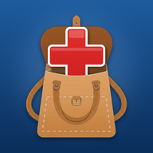

# LeSacAUrge



Application web installable (PWA) pour téléphone et ordinateur : saisie au clavier
ou par la dictée vocale du clavier des paragraphes d'une observation d'urgence, puis
copie en **texte brut** d'un clic dans le logiciel d'observation.

©2026 LESACA Julien Tous droits réservés.

## Fonctions

- **Bandeau patient toujours visible** (localisation, identité, sexe, âge), coloré :
  rose femme, bleu homme, vert mineur (prioritaire), gris sexe non renseigné.
  Toucher le bandeau pour modifier ; bouton + pour un nouveau patient.
- **Barre de navigation** entre les encarts, toujours visible ; la pastille active suit
  le défilement, un point indique les encarts remplis.
- Encarts : Motif (masquable), Anamnèse, Antécédents médicaux, Antécédents chirurgicaux,
  Traitements habituels, Allergies, Examen clinique, Hypothèses diagnostiques, **ECG**,
  Conduite à tenir, Évolution, Conclusion.
- Un bouton **Copier** par encart + **Tout copier** (Ctrl+Maj+C) ; raccourcis Alt+1 à Alt+9.
- Copie en texte brut (guillemets, tirets, puces, émojis normalisés ; œ devient oe).
  Option « compatibilité stricte » qui retire aussi les accents.
- Pastilles préremplies, activables d'un toucher, personnalisables dans les réglages.
- Examen clinique : case « examen normal complet » ou sélection par appareil, constantes.
- **ECG** : bouton « ECG normal » (« RSR d'axe non dévié, à xx bpm, sans trouble de la
  conduction ni de la repolarisation, QTc à xx ms. »), saisie FC et QTc, anomalies à
  cocher (rythme, axe, conduction, repolarisation, autres) qui réécrivent la phrase.
  Si le texte a été modifié à la main, il n'est jamais écrasé sans confirmation.
- **Évolution horodatée** : chaque entrée a son heure et son bouton Copier ;
  « Copier les nouvelles » ne copie que les entrées pas encore copiées.
- **Check-list** par patient (réévaluation, biologie, imagerie, ECG, traitement, scope,
  avis cardio / chir / neuro / autre, lit, appel, documents de sortie, éléments libres) :
  à faire (orange) puis fait (vert). Vue « Patients en cours » (icône en haut, avec le
  nombre de tâches à faire) regroupant tous les patients et leurs icônes.
- **Dictée vocale** (bouton micro rouge en bas, ou Alt+D), reprise de LeSacAMicroMed : le texte
  s'écrit dans l'encart indiqué en bas de l'écran (dernier encart touché, ou encart affiché).
  Moteurs : navigateur (Chrome, Edge, Safari), API de transcription (Mistral Voxtral ou compatible
  OpenAI, clé personnelle gardée sur l'appareil), ou dictée du clavier suivie de « Mise en forme ».
- **Commandes vocales** : ponctuation (« virgule », « point à la ligne », « deux points »…), mise en
  page (« à la ligne », « nouveau paragraphe », listes), majuscules, correction (« efface le dernier
  mot », « efface la dernière phrase », « annule la dernière action »), actions (« copie le texte »,
  « vérifie le texte », « arrête la dictée »). Propres à LeSacAUrge : « encart examen », « aller à
  l'évolution », « passe aux antécédents »… pour changer d'encart, « valide l'entrée » pour ajouter
  l'entrée d'évolution dictée. Liste complète : bouton « ? » de la barre de dictée.
- **Lexique médical intégré** (2 892 termes, 1 243 abréviations, 3 156 noms de médicaments) :
  accents, sigles en capitales, médicaments, mots coupés reconstitués, unités (mg, µg, mmHg, °C…),
  « 13 sur 8 » → 13/8, « 38 virgule 5 » → 38,5.
- **Textes types** (bouton « Textes » ou « insère *nom* ») avec **champs à compléter** […] :
  le premier champ est sélectionné, on dicte directement ; « champ suivant » ou Tab pour passer au
  suivant ; les champs restés vides ne sont jamais copiés. Proposés : examen normal, ECG normal,
  retour à domicile. Gestionnaire dans les réglages ; création depuis la sélection.
- **Dictionnaire personnel** (« ce qui est dit = ce qui doit être écrit »), prioritaire.
- Dictionnaire personnel et textes types **synchronisés** entre les appareils (chiffrés).
- **Vérification** orthographe et grammaire de l'encart (bouton « Vérifier » de chaque encart ou de
  la barre de dictée) avec LanguageTool ; les termes médicaux et le dictionnaire personnel ne sont pas
  signalés ; « Ajouter au dictionnaire ».
- **Définitions** : sélectionner un mot (ou bouton « Définition ») ; abréviations et médicaments
  intégrés (hors ligne), autres mots par Wiktionnaire puis Wikipédia (seul le mot est envoyé).
- **Glisser-déposer** : poignée de chaque encart, ou « Glisser » de la barre de dictée pour
  l'observation complète, vers le logiciel d'observation (texte brut). Sur ordinateur et tablette.
- Fonctionne hors ligne (sauf reconnaissance vocale du navigateur, vérification et définitions en
  ligne), thème clair/sombre, installable sur l'écran d'accueil.
- Synchronisation téléphone et ordinateur, **chiffrée de bout en bout**.
  L'identité (nom) n'est synchronisée que si l'option est activée dans les réglages.

## Installation (hébergement GitHub Pages)

1. Fusionner la branche dans `main`.
2. GitHub : Settings > Pages > Source : **GitHub Actions**. Le workflow
   `.github/workflows/pages.yml` publie le site à chaque push sur `main`.
   (GitHub Pages sur un dépôt privé nécessite un abonnement payant GitHub.)
3. Ouvrir l'adresse publiée ; sur téléphone : Partager > « Sur l'écran d'accueil »
   (iPhone) ou menu > « Installer l'application » (Android/Chrome/Edge).

## Synchronisation (facultative)

Backend : Firebase Realtime Database (offre gratuite Spark), accédée par son API REST.

1. console.firebase.google.com > nouveau projet > Realtime Database > créer
   (région europe-west1).
2. Onglet Règles : coller `database.rules.json`, publier.
3. Dans l'application (ordinateur) : Réglages > coller l'adresse de la base > Générer un
   code > Activer. Un QR code s'affiche.
4. Téléphone : scanner le QR code avec l'appareil photo > l'application s'ouvre jumelée.

L'adresse de la base du projet (`https://lesacaurge-default-rtdb.europe-west1.firebasedatabase.app`)
est pré-remplie sur tous les appareils via `js/config.js` : il suffit de générer un code
sur l'ordinateur puis de scanner le QR code avec le téléphone.

Sécurité : chaque texte est chiffré dans le navigateur (AES-GCM 256, clé dérivée du
code de jumelage par PBKDF2-SHA256, 150 000 itérations). Le serveur ne stocke que des
données chiffrées, rangées sous un identifiant dérivé du code (SHA-256). Le code de
jumelage (100 bits) ne transite jamais vers le serveur ; le lien de jumelage le porte
dans le fragment `#` de l'URL, qui n'est pas transmis au serveur web.

## Avertissement réglementaire

Ni cette application ni Firebase ne sont certifiés « Hébergeur de données de santé »
(HDS, article L.1111-8 du Code de la santé publique). Le bandeau permet de saisir
l'identité du patient : elle reste par défaut sur l'appareil où elle est saisie et
n'est envoyée (chiffrée) que si l'option correspondante est activée.

La dictée et la vérification envoient des données hors de l'appareil, **en clair** pour ces
prestataires : l'audio (Google ou Microsoft avec Chrome/Edge, Apple avec Safari, Mistral ou OpenAI
avec l'API) et le texte vérifié (LanguageTool GmbH, Allemagne). Aucun n'est, à ma connaissance,
certifié HDS. Ne dictez ni ne vérifiez d'éléments identifiants du patient sans l'accord de votre
établissement ; un serveur LanguageTool auto-hébergé évite l'envoi du texte. Vérifiez la politique de sécurité de
votre établissement avant d'utiliser un appareil personnel ou un service cloud.

## Modules repris de LeSacAMicroMed

`js/lexique.js`, `js/lexique-medical.js`, `js/pipeline.js`, `js/speech.js` et `js/definitions.js`
sont des copies **à l'identique** de LeSacAMicroMed (même auteur), avec leurs tests (`npm test`).
Pour les mettre à jour, recopier les fichiers depuis LeSacAMicroMed puis lancer `npm test`.
Sources et licences du lexique médical : voir le README de LeSacAMicroMed (Grammalecte / Hunspell
MPL 2.0, Wikipédia CC BY-SA, Base de données publique des médicaments ANSM Licence Ouverte).
`js/dictee.js` relie ces modules aux encarts de LeSacAUrge (texte brut, sans espaces insécables).

Moteurs de reconnaissance : la reconnaissance du navigateur n'est pas disponible dans Firefox ni
dans l'application installée sur l'écran d'accueil d'un iPhone/iPad ; utiliser alors la dictée du
clavier puis « Mise en forme », ou une API de transcription.

## Structure

```
index.html            interface
css/styles.css        styles (thème clair/sombre)
js/data.js            encarts, pastilles, examen normal, constantes
js/app.js             logique (dossiers, copie, réglages)
js/sync.js            synchronisation chiffrée
js/dictee.js          dictée, commandes, textes types, dictionnaire, vérification, définitions
js/lexique*.js, js/pipeline.js, js/speech.js, js/definitions.js   repris de LeSacAMicroMed
tests/                tests du traitement de la dictée (npm test)
js/config.js          configuration (adresse Firebase par défaut)
js/vendor/qrcode.js   générateur de QR code (MIT)
sw.js                 hors ligne
database.rules.json   règles de sécurité Firebase
```
